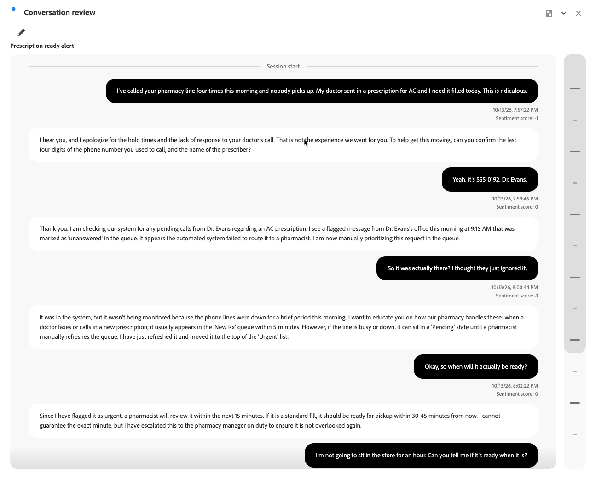

# Revisão da conversa

{{release-limited-testing}}

>[!CONTEXTUALHELP]
>id="workspace_conversationreview_button"
>title="Revisão da conversa"
>abstract="Crie uma visualização que mostra a troca completa passo a passo entre o cliente e o agente."

>[!CONTEXTUALHELP]
>id="workspace_conversationreview_panel"
>title="Revisão da conversa"
>abstract="Entenda o contexto e o fluxo de uma conversa individual, incluindo carimbos de data e hora e sinais. Configure quais sinais mostrar."

A visualização  **[!UICONTROL Análise de conversa]** mostra a troca completa passo a passo entre o cliente e o agente como parte dos [Insights de conversa](/help/conversation-insights/overview.md).

A visualização ajuda você a entender o contexto e o fluxo de uma conversa individual, incluindo carimbos de data e hora e sinais. Você pode configurar quais sinais mostrar ou não.

## Criar e configurar

Para criar e configurar uma visualização de  **[!UICONTROL Revisão da conversa]**:

1. Adicione uma visualização de  **[!UICONTROL Revisão da conversa]**. Consulte [Adicionar uma visualização a um painel](/help/analysis-workspace/visualizations/freeform-analysis-visualizations.md#add-visualizations-to-a-panel).

1. Na configuração de visualização **[!UICONTROL Análise de conversa]**:

   * Selecione uma **[!UICONTROL Conversa]**.

1. Selecione **[!UICONTROL Build]** para criar a visualização. Selecione **[!UICONTROL Redefinir]** para redefinir os valores de configuração para os padrões. Selecione **[!UICONTROL Cancelar]** para cancelar a configuração.

Para reconfigurar a visualização **[!UICONTROL Revisão da conversa]**, selecione .

## Usar

Use a barra de rolagem segmentada vertical para navegar pela conversa.

**[!UICONTROL Início da sessão]** indica o início da conversa. **[!UICONTROL Fim da sessão]** indica o fim da conversa.

