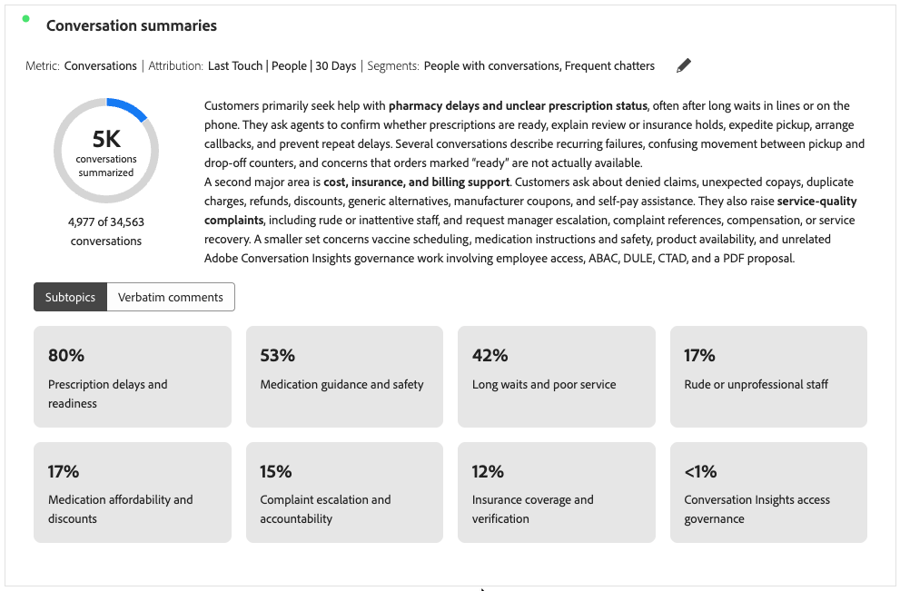
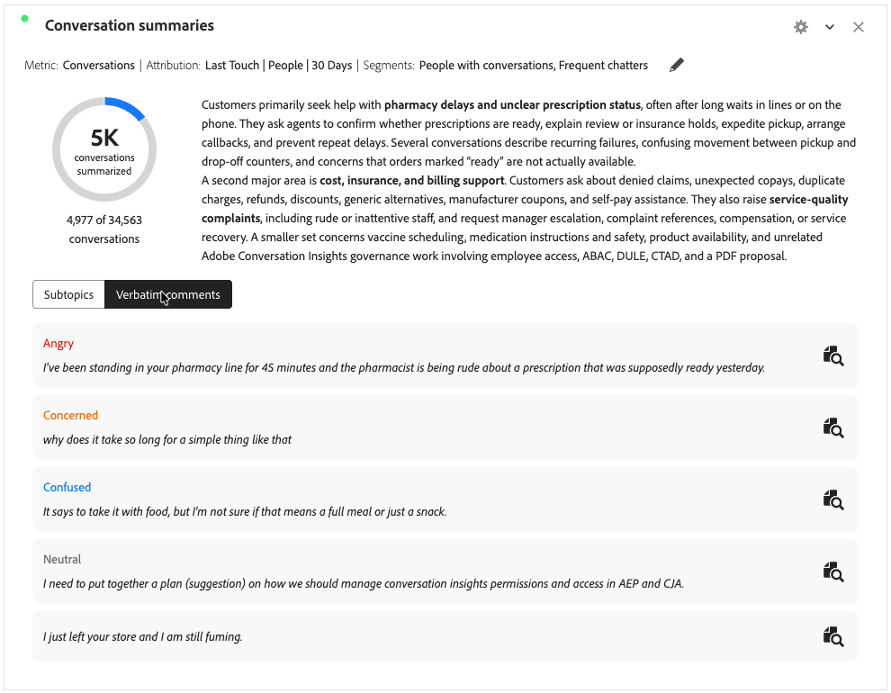

# Resumos da conversa {#conversation-summaries}

>[!CONTEXTUALHELP]
>id="workspace_conversationsummaries_button"
>title="Resumos da conversa"
>abstract="Crie uma visualização que resume um grupo filtrado de conversas."

>[!CONTEXTUALHELP]
>id="workspace_conversationsummaries_panel"
>title="Resumos da conversa"
>abstract="Resumir um grupo filtrado de conversas. Controlar o comprimento do resumo. Veja citações representativas de clientes para validar a precisão dos sinais extraídos. Selecione uma cotação para abrir a repetição completa da conversa."

{{release-limited-testing}}

A visualização dos ![Resumos de conversa **[[!UICONTROL IA]](/help/assets/icons/AI.svg)]** permite resumir um grupo filtrado de conversas como parte dos [Insights de conversa](/help/conversation-insights/overview.md).

A visualização mostra um resumo da métrica selecionada (por exemplo, Conversas) e exibe subtópicos ou comentários textuais quando você configura a visualização para incluir subtópicos.

## Criar e configurar {#conversation-summaries-create-configure}

>[!CONTEXTUALHELP]
>id="workspace_conversationsummaries_usenondefaultattributionmodel"
>title="Usar modelo de atribuição não-padrão"
>abstract="Ativar um modelo de atribuição não padrão para essa métrica."

>[!CONTEXTUALHELP]
>id="workspace_conversationsummaries_usenondefaultattributionmodel_disabled"
>title="Usar modelo de atribuição não-padrão"
>abstract="Modelos de atribuição não padrão não estão disponíveis para esta métrica."

Para criar e configurar uma visualização de **[!UICONTROL Resumos da conversa]**:

1. Adicione uma visualização de  **[!UICONTROL IA]**. Consulte [Adicionar uma visualização a um painel](/help/analysis-workspace/visualizations/freeform-analysis-visualizations.md#add-visualizations-to-a-panel).

1. Na configuração de visualização dos **[!UICONTROL resumos da conversa]**:

   1. Selecione uma **[!UICONTROL métrica]**. Por exemplo: **[!UICONTROL Conversas]**.
   1. Opcionalmente, se quiser usar um modelo não padrão [atribuição](/help/analysis-workspace/attribution/models.md) na métrica, selecione **[!UICONTROL Usar modelo de atribuição não padrão]** e selecione **[!UICONTROL Modelo]**, **[!UICONTROL Contêiner]** e **[!UICONTROL Janela de pesquisa]**.
   1. Opcionalmente, é possível aplicar um segmento à visualização. Selecione um segmento no menu suspenso **[!UICONTROL Segmentos]**.

1. Selecione **[!UICONTROL Build]** para criar a visualização. Selecione **[!UICONTROL Redefinir]** para redefinir os valores de configuração para os padrões. Selecione **[!UICONTROL Cancelar]** para cancelar a configuração.

Para reconfigurar a visualização dos **[!UICONTROL Resumos da conversa]**, selecione  ao lado de **[!UICONTROL Métrica: _métrica_]**&#x200B;ou **[!UICONTROL Métrica:_métrica_]** | **[!UICONTROL Segmentos: _segmentos_]**.

## Usar

Para usar a visualização:

>[!BEGINTABS]

>[!TAB Subtópicos]

>[!TAB Comentários textuais]

>[!ENDTABS]

* Se você tiver [subtópicos incluídos](#settings), selecione **[!UICONTROL Subtópicos]** para exibir subtópicos ou **[!UICONTROL Comentários integrais]** para exibir comentários integrais.
* Quando você tiver selecionado **[!UICONTROL Comentários textuais]**, selecione  para abrir uma nova visualização de [**[!UICONTROL Revisão da conversa]**](./conversation-review.md) para a conversa específica da qual o comentário textual faz parte.

Para navegar rapidamente por várias revisões de conversas:

1. Crie uma [tabela de forma livre](/help/analysis-workspace/visualizations/freeform-table/freeform-table.md) com **[!UICONTROL ID de Conversa]** e **[!UICONTROL Nome de Conversa]** como dimensões.
1. Selecione a tabela de forma livre como fonte de dados para a visualização **[!UICONTROL Análise de conversa]**.

Selecione uma conversa na tabela de forma livre para atualizar a **[!UICONTROL Revisão da conversa]** automaticamente com os detalhes dessa conversa selecionada.

## Configurações

As [configurações de visualização](/help/analysis-workspace/visualizations/freeform-analysis-visualizations.md#settings) específicas a seguir estão disponíveis.

| Configuração | Descrição |
|---|---|
| **[!UICONTROL Comprimento do resumo]** | Especifique o comprimento do resumo. Você pode selecionar entre **[!UICONTROL Short]** ou **[!UICONTROL Long]**. |
| **[!UICONTROL Incluir subtópicos]** | Selecione **[!UICONTROL Incluir subtópicos]** para exibir subtópicos na visualização. Use **[!UICONTROL Número máximo de subtópicos]** para configurar o número máximo de subtópicos a serem exibidos. |
