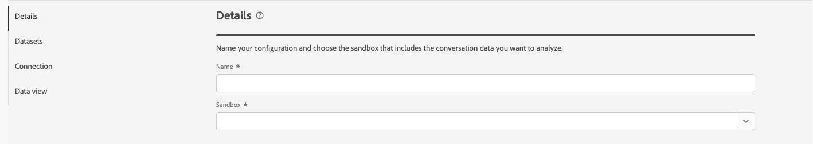
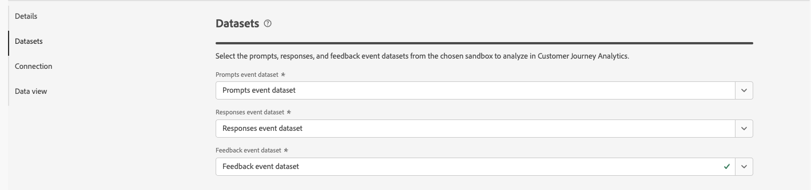
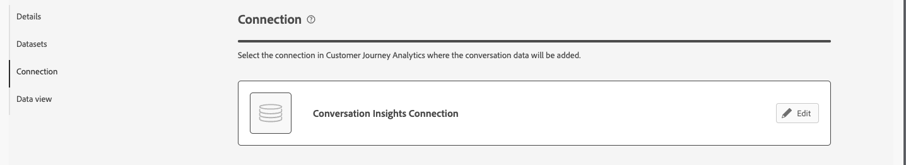
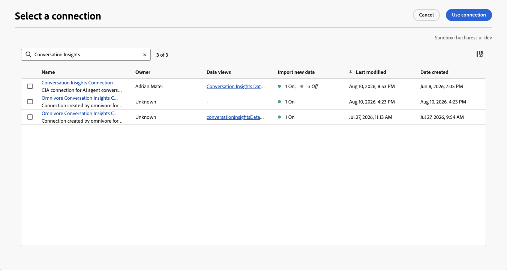

# Criar ou editar configurações

{{release-limited-testing}}

O Conversation Insights permite analisar conversas a partir das experiências de agente que você oferece aos seus clientes. Essas experiências de agente podem ser baseadas em grandes modelos de linguagem (LLM) ou baseadas em conversas humanas. Por exemplo, um chatbot interagindo com um cliente ou transcrições da central de atendimento.
Por meio dos Insights de conversa, é possível entender o impacto dos agentes nos resultados reais do usuário.

Por meio da interface de configuração do Conversation Insights, é possível criar ou editar rapidamente uma configuração e os artefatos associados (conexão, visualizações de dados e muito mais).

Ao criar ou editar uma configuração de Insights de conversa, você especifica a sandbox e os conjuntos de dados de evento que contêm prompts, respostas e dados de feedback. Você também seleciona a conexão do Customer Journey Analytics à qual deseja adicionar esses conjuntos de dados. E a visualização de dados à qual você deseja adicionar as métricas e dimensões do Conversation Insights.

Somente administradores do sistema podem criar ou editar configurações de Insights de conversa.

Você cria ou edita configurações da [interface de Configurações de Insights de Conversa](./manage.md).

## Restaurar o conjunto de dados combinados ausente

Se você editar uma configuração e o conjunto de dados misturado que foi gerado para a configuração não existir mais, selecione **[!UICONTROL Restaurar]** para regenerar o conjunto de dados misturado.

## Etapas de configuração

Para cada configuração:

1. Na seção **[!UICONTROL Detalhes]**, especifique as seguintes informações:

   

   | Campo | Descrição |
   |---------|----------|
   | **[!UICONTROL Nome]** | Especifique um nome para a configuração. |
   | **[!UICONTROL Sandbox]** | Selecione a sandbox da Experience Platform que contém os conjuntos de dados de eventos de prompts, respostas e comentários que você deseja adicionar à sua conexão. Você será notificado se nenhum conjunto de dados compatível estiver disponível para a sandbox selecionada. |

1. Na seção **[!UICONTROL Conjuntos de dados]**, especifique as seguintes informações:

   

   | Campo | Descrição |
   |---------|----------|
   | **[!UICONTROL Solicita o conjunto de dados do evento]** | Selecione o conjunto de dados que contém os dados do evento de prompts. |
   | **[!UICONTROL Conjunto de dados de evento de respostas]** | Selecione o conjunto de dados que contém os dados do evento de respostas. |
   | **[!UICONTROL Conjunto de dados do evento de comentários]** | Selecione o conjunto de dados que contém os dados do evento de feedback. |

   Quando um conjunto de dados contém prompts e respostas, selecione o mesmo conjunto de dados para o **[!UICONTROL conjunto de dados de eventos de Prompts]** e o **[!UICONTROL conjunto de dados de eventos de Respostas]**.

   A opção para [especificar conversações mescladas](#blend-specification) até **[!UICONTROL Configurar especificação mesclada]** está disponível somente uma vez:
   * Essa configuração foi concluída.
   * Todos os conjuntos de dados estão disponíveis.
   * Você tem [permissões do Customer Journey Analytics para editar conexões](/help/technotes/access-control.md).

1. Na seção **[!UICONTROL Conexão]**, se nenhuma conexão já estiver configurada, use **[!UICONTROL Selecionar uma conexão]** para selecionar uma conexão.

   

   Se uma conexão já estiver configurada, selecione  **[!UICONTROL Editar]** para selecionar outra conexão.

   

   Na caixa de diálogo **[!UICONTROL Selecionar uma conexão]**:

   

   1. Marque a caixa de seleção ao lado da conexão à qual você deseja adicionar os conjuntos de dados de eventos de prompts, respostas e feedback.
   1. Selecione **[!UICONTROL Usar conexão]**.

   * Para pesquisar na lista de conexões para seleção, use o campo .
   * Para configurar quais colunas serão exibidas na tabela, selecione . Na caixa de diálogo **[!UICONTROL Personalizar tabela]**, selecione as colunas a serem mostradas. Em seguida, selecione **[!UICONTROL Aplicar]**.

1. Na seção **[!UICONTROL Visualizações de dados]**, se nenhuma visualização de dados já estiver configurada, selecione **[!UICONTROL Selecionar visualizações de dados]** para selecionar visualizações de dados.

   Se as visualizações de dados já estiverem configuradas, selecione  **[!UICONTROL Editar seleção de visualização de dados]** para reconfigurar a seleção de visualizações de dados.

   Na caixa de diálogo **[!UICONTROL Selecionar várias visualizações de dados]**:

   

   1. Selecione uma ou mais visualizações de dados que deseja usar para a configuração de Insights de conversa.

   1. Selecione **[!UICONTROL Usar visualizações de dados]** para usar as visualizações de dados. Selecione Cancelar para cancelar.

   * Para pesquisar na lista de visualizações de dados para seleção, use o campo .
   * Para configurar quais colunas serão exibidas na tabela, selecione . Na caixa de diálogo **[!UICONTROL Personalizar tabela]**, selecione as colunas a serem mostradas. Em seguida, selecione **[!UICONTROL Aplicar]**.

1. Para concluir a configuração:

   * Selecione **[!UICONTROL Descartar]** para uma nova configuração que não foi criada.

   * Selecione **[!UICONTROL Salvar para mais tarde]** para obter uma nova configuração que você deseja salvar, mas que não deseja criar o artefato para (atualizações em visualizações de dados, por exemplo). Você pode revisitar a configuração posteriormente e concluir a criação real da configuração.

   * Selecione **[!UICONTROL Criar]** para criar a nova configuração.

   * Selecione **[!UICONTROL Salvar]** para salvar a configuração modificada.

   * Selecione **[!UICONTROL Restaurar]** para restaurar a configuração e regenerar um novo conjunto de dados mesclado para a configuração.

   * Selecione **[!UICONTROL Sair]** para ignorar qualquer alteração na configuração.

## Especificação de mesclagem

>[!CONTEXTUALHELP]
>id="conversationinsights_blend_specification"
>title="Configurar especificação de mesclagem"
>abstract="Você só poderá editar a especificação de mesclagem depois de concluir essa configuração do Conversation Insights, de todos os conjuntos de dados estarem disponíveis e de você ter permissões do Customer Journey Analytics para editar conexões."
>additional-url="https://experienceleague.adobe.com/pt-br/docs/analytics-platform/using/technotes/access-control" text="Controle de acesso"

>[!CONTEXTUALHELP]
>id="conversationinsights_dataset_winner"
>title="Conjunto de dados vencedor"
>abstract="Selecione o conjunto de dados que determina o valor do campo ou dos campos nomeados correspondentemente (se um container) no conjunto de dados de conversa mesclada."

Depois de criar uma configuração, você pode configurar [como as conversas dos conjuntos de dados de prompts, respostas, comentários e sinais são misturadas](/help/conversation-insights/overview.md#how-it-works).

Essa especificação permite selecionar o conjunto de dados que determina o valor do campo ou dos campos nomeados correspondentemente (se um container) no conjunto de dados de conversação combinado.

Por exemplo: se você quiser que o nome do campo **[!UICONTROL Produzido por]** no conjunto de dados de conversação misturado seja definido a partir desse campo com nome semelhante no conjunto de dados de feedback, selecione **[!UICONTROL Conjunto de dados de feedback]** no menu suspenso **[!UICONTROL Vencedor do conjunto de dados]** para esse campo.

Para especificar a conversa mesclada:

1. Selecione **[!UICONTROL Configurar especificação de mistura]**.

1. Na caixa de diálogo **[!UICONTROL Especificação de mesclagem]**, para cada **[!UICONTROL Nome do campo]**, revise o **[!UICONTROL vencedor do conjunto de dados]** sugerido e, opcionalmente, selecione um conjunto de dados diferente.

   * Para cada campo habilitado, selecione opcionalmente outro **[!UICONTROL vencedor do Conjunto de Dados]**. Você pode selecionar entre **[!UICONTROL Conjunto de dados de prompts]**, **[!UICONTROL Conjunto de dados de respostas]** e **[!UICONTROL Conjunto de dados de feedback]**.
   * Para cada campo de contêiner, opcionalmente selecione outro **[!UICONTROL vencedor do conjunto de dados]** para atualizar todos os campos que pertencem ao contêiner. Você pode selecionar entre **[!UICONTROL Conjunto de dados de prompts]**, **[!UICONTROL Conjunto de dados de respostas]** e **[!UICONTROL Conjunto de dados de feedback]**.
   * Você não pode selecionar um **[!UICONTROL vencedor do conjunto de dados]** para campos compartilhados entre os conjuntos de dados da conversa (prompts, respostas, feedback e sinais). Esses campos fazem parte dos seguintes grupos de campos:

     | Nome do campo | Grupo de campos | Conjunto de dados vencedor |
     |---|---|---|
     | **[!UICONTROL prompt]** | `conversation.prompt.*` | **[!UICONTROL Conjunto de dados de prompts]** |
     | **[!UICONTROL response]** | `conversation.response.*` | **[!UICONTROL Conjunto de dados de respostas]** |
     | **[!UICONTROL comentários]** | `conversation.feedback.*` | **[!UICONTROL Conjunto de dados de comentários]** |
     | **[!UICONTROL agentExperience]** | `agentExperience.*` | **[!UICONTROL Conjunto de dados de respostas]** |
     | **[!UICONTROL sinais]** | `conversation.signals.*` | **[!UICONTROL Conjunto de dados de sinais]** |

   * Nenhuma seleção **[!UICONTROL Vencedora do Conjunto de Dados]** está disponível para campos de identidade específicos, como **[!UICONTROL ID de Conversa]** ou **[!UICONTROL ID de Virada]**.

1. Selecione **[!UICONTROL Salvar]** para salvar a especificação. Selecione **[!UICONTROL Cancelar]** para cancelar a especificação.

## Verificação de visualização de dados

As visualizações de dados configuradas em [Etapas de configuração](#configuration-steps) têm **[!UICONTROL Insights de conversa]** como valor para **[!UICONTROL Integrações]** em [Visualizações de dados](/help/data-views/manage-dataviews.md).

Para cada uma das visualizações de dados configuradas:

* **Contêineres**: a [guia Contêineres](/help/data-views/create-dataview.md#containers) contém um novo **[!UICONTROL Nome do contêiner]**: **[!UICONTROL Conversação]** com **[!UICONTROL Nome de exibição]**: **[!UICONTROL Contêiner]** como um **[!UICONTROL Sistema]** **[!UICONTROL Tipo de contêiner]** adicional.
* **Componentes**: você vê pastas adicionais de campo de esquema. Por exemplo: agentExperience e chat. Além disso, os seguintes componentes são adicionados automaticamente:

  | Métricas | Tipo de dados de esquema | Caminho do esquema |
  |---|---|---|
  | Feedbacks do cliente | String | eventType |
  | Sentimentos positivos | String | Campos derivados |
  | Recomendações | String | eventType |
  | Turnos | String | eventType |

  | Dimensões | Tipo de dados de esquema | Caminho do esquema |
  |---|---|---|
  | ID do agente | String | `agenticExperience.agents.agentID` |
  | Nome do agente | String | `agenticExperience.agents.name` |
  | Nome do concierge | String | `agenticExperience.name` |
  | Versão do concierge | String | `agenticExperience.version` |
  | ID da conversa | String | `conversation.conversationID` |
  | Nome da conversa | String | `conversation.conversationName` |
  | Nome do sinal da conversa | String | `conversation.signals.name` |
  | Valor booleano do resumo da conversa | Booleano | `conversation.signals.values.booleanValue` |
  | Confiança do resumo da conversa | Duplo | `conversation.signals.values.confidence` |
  | Chave de metadados do resumo da conversa | String | `conversation.signals.values.metadata.key` |
  | Valor numérico do resumo da conversa | Duplo | `conversation.signals.values.numberValue` |
  | Qualificadores do resumo da conversa | String | `conversation.signals.values.qualifiers` |
  | Sinais de tom da conversa | String | `conversation.signals.attributes.tones.values` |
  | Ambiente | String | `agenticExperience.environment` |
  | Classificação do feedback | String | Campos derivados |
  | Classificação de avaliação de feedback | String | `conversation.feedback.rating.classification` |
  | Finalidade da seção de feedback | String | `conversation.feedback.raw.purpose` |
  | Fonte do feedback | String | `conversation.feedback.source` |
  | Frase | String | `conversation.signals.attributes.subjects.values.phrase` |
  | Texto não processado da resposta | String | `conversation.response.raw.text` |
  | Fonte da resposta | String | `conversation.response.source` |
  | Classificação de sentimentos | String | Campos derivados |
  | Nome da habilidade | String | `agenticExperience.agents.skills.name` |
  | Versão da habilidade | String | `agenticExperience.agents.skills.version` |
  | Valor | String | `agenticExperience.agents.skills.parameters.value` |

<!--

1. In the Data views dialog, select the checkbox next to one or more data views that you want to use when analyzing Experience Platform audience data within Analysis Workspace. These data views are automatically configured with Experience Platform audience data for reporting.

1. Select **[!UICONTROL Use data views]**.

1. Select **[!UICONTROL Create]** to create the configuration.

   >[!IMPORTANT]
   >
   >Because the profile dataset is updated once per day, audiences are available in Customer Journey Analytics data views on the day after you create the audience analysis configuration.

1. After 24 hours, [view audience dimensions in the data view](#view-audience-dimensions-in-the-data-view) to verify that the audience dimensions are available in the data views that you selected. 

## View audience dimensions in the data view

After you [create an audience analysis configuration](#create-an-audience-analysis-configuration), you can verify that audience dimensions were added to the data views that you selected during the configuration.

To view audience dimensions in the data view, you must be a product profile administrator for the product profile that the data view is assigned to. For more information, see [Access control](/help/technotes/access-control.md).

To view the audience analysis dimensions in the data view:

1. In Customer Journey Analytics, select **[!UICONTROL Data Management]** > **[!UICONTROL Data views]**.

1. In the **[!UICONTROL Dimensions]** section, the following dimensions should now be available:

   * **[!UICONTROL Audience Name]**

   * **[!UICONTROL Audience Origin]**

   * **[!UICONTROL Exited Audience Origin]**

   * **[!UICONTROL Exited Audience Name]**

   Note that each of these dimensions was added to the profile dataset that is associated with the merge policy that you selected during the audience analysis configuration, and each was added to the new lookup dataset that was created.

   

1. Use the audience analysis dimensions in Analysis Workspace. 

   Users who have access to use the data view in Analysis Workspace can now see the new dimensions and use them in their analyses. For information about how to use the audience analysis dimensions in Analysis Workspace, see [Analyze Experience Platform audiences in Customer Journey Analytics](/help/connections/audience-analysis/analyze-audiences.md).

-->