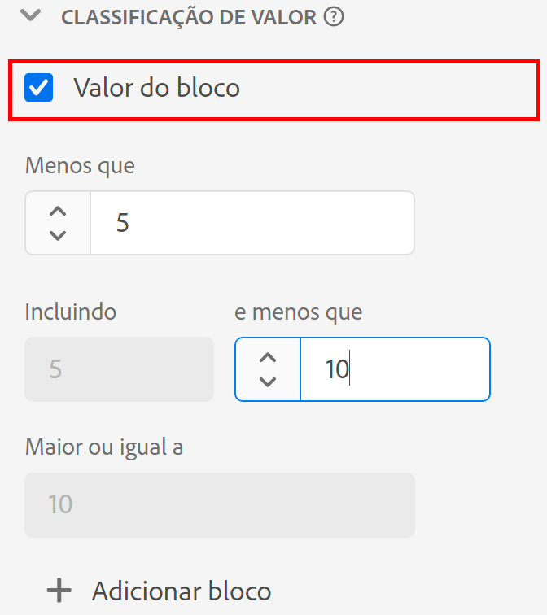

# Configurações do componente [!UICONTROL Agrupamento de valores em buckets] {#value-bucketing-component-settings}

<!-- markdownlint-disable MD034 -->

>[!CONTEXTUALHELP]
>id="dataview_component_dimension_value_bucketing"
>title="Agrupamento de valores em buckets"
>abstract="Valores de bloco em intervalos específicos. Estes intervalos aparecem como itens de dimensão nos relatórios."

<!-- markdownlint-enable MD034 -->

Ao criar ou editar uma visualização de dados, o agrupamento de valores em buckets permite combinar valores numéricos com base em um intervalo. Essa função está disponível apenas para dimensões que utilizam tipos de dados Integer ou Double do esquema.

O agrupamento de valores em buckets é importante quando você deseja agrupar intervalos, em vez de tratar cada número único como um item de dimensão separado. Por exemplo, um bucket “Entre 5 e 10” será exibido como um item de linha “5 a 10” no Analysis Workspace.

Se você quiser a flexibilidade de criar relatórios sobre dimensões agrupadas em buckets ou não agrupadas, arraste duas cópias do componente para a lista de dimensões disponíveis. Habilite o agrupamento em buckets em uma dimensão e desabilite na outra.

| Configuração | Descrição |
| --- | --- |
| [!UICONTROL Valor do bloco] | Uma caixa de seleção que permite habilitar o agrupamento em buckets. |
| [!UICONTROL Menos que] | O limite superior do primeiro bucket de dimensão. |
| [!UICONTROL Incluindo] [!UICONTROL e menor que] | Limites dos buckets subsequentes. |
| [!UICONTROL Maior que ou igual a] | O limite inferior do último bucket de dimensão. |
| [!UICONTROL Adicionar bloco] | Permite adicionar outro bucket ao agrupamento de dimensões numéricas em buckets. Você pode adicionar até 20 buckets em uma única dimensão. |

{style="table-layout:auto"}
