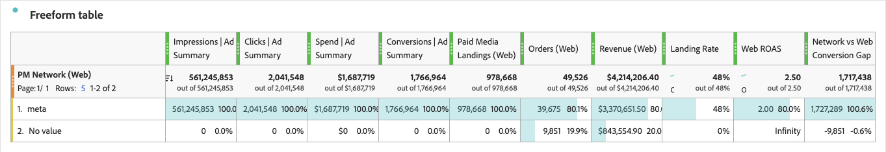

# Associar dados de mídia paga com dados da Web

Este guia de caso de uso ilustra como você pode associar dados de resumo de mídia paga com dados de evento comportamentais do site no [!DNL Adobe Customer Journey Analytics].


A conexão de suas contas de anúncio (Meta, Google Ads e outros) com o Experience Platform fornece dados de resumo de mídia paga no Customer Journey Analytics: impressões diárias, cliques, gastos e conversões relatadas pela rede de anúncios por conta, campanha, grupo de anúncios, anúncio, experiência e ativo. Com o Customer Journey Analytics, você coleta seus próprios dados de evento comportamental no site com o Web SDK: exibições de página, pedidos, receita.

Ao unir os dois tipos de dados em uma única tabela de forma livre do Workspace, é possível comparar o desempenho da publicidade com a atividade no seu site. Use campanhas, grupos de anúncios e IDs de anúncios compartilhados para criar relatórios sobre impressões, cliques e gastos, juntamente com aterrissagens, pedidos e receita pagos em [!DNL Analysis Workspace].

| Fonte de dados | Exemplo de métricas |
|---|---|
| Dados de resumo de mídia paga | Impressões, cliques, gastos, conversões e valor de conversão relatados pela rede de anúncios. |
| Eventos comportamentais do site | Páginas de aterrissagem pagas, exibições de página, pedidos e receita medidos em seu site |
| Métricas calculadas | Taxa de página de aterrissagem, taxa de conversão da Web, retorno da Web sobre o investimento em anúncios, custo por pedido da Web e lacuna de conversão entre a rede e a Web |

A combinação desses dois tipos de dados permite comparar dados de pré-clique (de seus anúncios) e dados de pós-clique (de seu site).

Este guia aborda cenários baseados em conexões gerenciadas por [!DNL Adobe Content Analytics] configurações e conexões que você mesmo configura.

## Como funciona

O diagrama abaixo ilustra como os dados de resumo de mídia paga e os dados de evento comportamental do site são assimilados por meio de uma conexão Customer Journey Analytics.

A visualização de dados é responsável pela análise e alinhamento dos dados, para que você possa usar o Workspace para criar relatórios corretamente sobre os dados.

{zoomable="yes"}

Os conjuntos de dados de resumo de mídia paga contêm métricas diárias sem uma ID de pessoa. Conjuntos de dados de eventos do site contêm eventos comportamentais com carimbo de data e hora e um identificador de pessoa. Um grupo de dados de resumo associa dimensões desses conjuntos de dados para que valores de dimensão iguais sejam exibidos na mesma linha de relatório.

>[!IMPORTANT]
>
>Essa junção alinha dados de resumo agregados e eventos da Web para relatórios. Não vincula uma impressão de anúncio ou clique a uma pessoa individual. As conversões de rede de anúncios retêm a metodologia de relatórios da rede. Os pedidos e a receita do site usam as configurações de atribuição definidas neste guia.

## Entender a associação de relatórios

Você pode ingressar somente nos níveis cujas IDs aparecem nos URLs da página inicial ou nos campos de evento existentes. Por exemplo, a marcação somente de campanha suporta relatórios de campanha, mas não de nível de anúncio. As associações de nível de experiência e de nível de ativo exigem parâmetros de URL adicionais e estão fora do escopo deste guia.

Consulte [Configurações do componente Grupo de dados de resumo](https://experienceleague.adobe.com/pt-br/docs/analytics-platform/using/cja-dataviews/summary-data) e [Configurações do componente Grupo de dados de resumo](https://experienceleague.adobe.com/en/docs/analytics-platform/using/cja-dataviews/component-settings/summary-data-group) para referência.

### Escolher a chave de junção

Os conjuntos de dados de mídia paga fornecem IDs de rede brutas e GUIDs (identificadores globais exclusivos) gerados pela Adobe.

| Identificador | Exemplo | Propósito |
|---|---|---|
| ID de rede | ID da campanha `123456789` | Corresponder uma ID capturada de um URL de página inicial a uma dimensão de resumo de mídia paga |
| GUID | `meta_111111111_123456789` | Identificar uma entidade de mídia paga usando a hierarquia de rede, conta e entidade |

A estrutura GUID é `{adNetwork}_{accountID}[_{campaignID}[_{adGroupID}[_{adID}]]]`. Os componentes de mídia paga gerenciados por [!DNL Adobe Content Analytics] usam essas GUIDs.

Este guia usa IDs de rede para ingressos na Web porque as macros de campanha, grupo de anúncios e URL de anúncios não fornecem todas as informações necessárias para reconstruir um GUID. Use estes campos de resumo:

| Nível de relatório | Campo de ID de rede | Campo GUID |
|---|---|---|
| Campanha | `paidMedia.campaignID` | `paidMedia.campaignGUID` |
| Grupo de publicidade | `paidMedia.adGroupID` | `paidMedia.adGroupGUID` |
| Publicidade | `paidMedia.adID` | `paidMedia.adGUID` |

O campo de rede é `paidMedia.adNetwork`. Os valores de exemplo incluem `meta` e `google_ads`. As saídas de campo derivadas devem corresponder exatamente aos valores em seus conjuntos de dados.

>[!NOTE]
>
>Um grupo de dados de resumo corresponde aos valores de dimensão, não a uma combinação de todas as dimensões na tabela. Confirme se as IDs escolhidas identificam as entidades sem ambiguidade nas contas e redes para as quais você faz relatórios. Grupos baseados em nome podem combinar entidades distintas que compartilham um nome.

## Pré-requisitos

Confirme se você tem:

* [!DNL Customer Journey Analytics] Selecione ou superior, com acesso às funções de campo derivadas usadas aqui: [Análise de URL](/help/data-views/derived-fields/derived-fields.md#url-parse), [Caso Quando](/help/data-views/derived-fields/derived-fields.md#case-when), [Substituição de Regex](/help/data-views/derived-fields/derived-fields.md#regex-replace) e, para enriquecimento de nome, [Pesquisa](/help/data-views/derived-fields/derived-fields.md#lookup).
* [!DNL Adobe Experience Platform] permissões para gerenciar esquemas, conjuntos de dados e fluxos de dados na sandbox de destino e acesso a conjuntos de dados e Serviço de consulta para verificação.
* [!DNL Customer Journey Analytics] permissão para editar a conexão de destino e a visualização de dados.
* Conectores de origem de mídia paga configurados na mesma sandbox e assimilação de conjuntos de dados de resumo e pesquisa. Para obter um conector de exemplo, consulte [origem do Meta Ads](https://experienceleague.adobe.com/en/docs/experience-platform/sources/connectors/advertising/meta-ads).
* Eventos do site que capturam o URL completo da página inicial, incluindo sua sequência de consulta, ou campos equivalentes contendo as IDs da rede.


### Marcação de anúncios

Identifique os parâmetros de consulta que contêm sua campanha, grupo de anúncios e IDs de anúncios. A marcação com base em ID existente pode ser usada sem alterações nas plataformas de anúncio.

| Padrão de marcação | Parâmetro de campanha | Parâmetro do grupo de anúncios | Parâmetro de anúncio |
|---|---|---|---|
| Meta IDs no URL do site | <code>campaign_id={{campaign.id}}</code> | <code>adset_id={{adset.id}}</code> | <code>ad_id={{ad.id}}</code> |
| IDs do Meta em parâmetros UTM | <code>utm_campaign={{campaign.id}}</code> | <code>utm_term={{adset.id}}</code> | <code>utm_content={{ad.id}}</code> |
| IDs do Google Ads em parâmetros UTM | <code>utm_campaign={campaignid}</code> | <code>utm_term={adgroupid}</code> | <code>utm_content={creative}</code> |

Para a marcação UTM do Meta, um valor de origem como `utm_source=fb` pode identificar a rede. Para a marcação UTM do Google Ads, use um valor de origem como `utm_source=google`.

Algumas integrações [!DNL Adobe Advertising] usam um valor `s_kwcid` com este layout:

```text
AL!<id>!3!{creative}!{matchtype}!{placement}!{network}!{product_partition_id}!{keyword}!{campaignid}!{adgroupid}
```

As regras de análise mais adiante neste guia se aplicam somente a este layout. Inspecione os URLs de aterrissagem reais antes de usá-los.

Se você não tiver acesso às plataformas de anúncios, inspecione os URLs de aterrissagem no conjunto de dados da Web. Você também pode inspecionar estes campos de pesquisa de mídia paga:

* Pesquisa de conta do Google Ads: `additionalDetails` entradas chamadas `google_ads_tracking_url_template` e `google_ads_final_url_suffix`.
* Pesquisa de anúncios Meta: `paidMedia.adDetails.creative.paidMediaCreative.destinationURL`.

As macros em URLs de destino armazenados podem ser codificadas por porcentagem. Valide as IDs expandidas em eventos reais do site em vez de supor que um URL armazenado represente o URL final de aterrissagem.

>[!IMPORTANT]
>
>Os nomes de campanha, como `utm_campaign=fall_sale`, não correspondem às IDs de campanha. Una-se somente em níveis que contenham IDs reais. Se as IDs estiverem ausentes, trabalhe com sua equipe de operações de anúncios para atualizar as marcações para o tráfego futuro; essa configuração não pode reconstruir IDs ausentes para as visitas históricas.

### Ponto inicial

Abra a visualização de dados que você planeja usar e inspecione os componentes para determinar o ponto inicial.

| | Ponto inicial | Configuração existente | Etapas a seguir |
|---|---|---|---|
| A | Content Analytics com mídia paga ou pela Web | Conjuntos de dados e componentes de mídia paga, além de conjuntos de dados de evento e pesquisa do Content Analytics | Adicione o conjunto de dados do evento do site, se necessário, e configure os campos derivados da Web e grupos de relatórios |
| B | Content Analytics somente com mídia paga | Conjuntos de dados e componentes de mídia paga; conjuntos de dados de pesquisa de conteúdo compartilhado também podem estar presentes | Adicione seu conjunto de dados de evento do site e configure os campos derivados da Web e grupos de relatórios |
| C | Mídia paga sem provisionamento do Content Analytics | Existem conjuntos de dados de mídia paga no Experience Platform, mas a conexão e a visualização de dados não contêm a configuração de mídia paga | Adicione o site e os conjuntos de dados de mídia paga, em seguida, crie a mídia paga e os componentes da Web |
| D | Content Analytics sem mídia paga | Somente componentes do Content Analytics | Ative o canal de mídia paga na configuração do Content Analytics e siga o caminho de configuração existente |

Não remova nem modifique conjuntos de dados provisionados pelo sistema ou componentes somente leitura ao estender uma conexão gerenciada pelo Content Analytics.

## Coletar eventos comportamentais do site

Ignore a criação de esquema, conjunto de dados e sequência de dados se o site já enviar os eventos necessários para um conjunto de dados usado no Customer Journey Analytics. Confirme se `web.webPageDetails.URL` inclui a cadeia de consulta da página de aterrissagem.

### Criar o esquema e o conjunto de dados

1. No Experience Platform, selecione a sandbox de destino.
1. Vá para **[!UICONTROL Gerenciamento de Dados]** > **[!UICONTROL Esquemas]** e selecione **[!UICONTROL Criar esquema]**.
1. Escolha **[!UICONTROL Manual]** e a classe `XDM ExperienceEvent`.
1. Nomeie o esquema, por exemplo `Web Behavioral Events`.
1. Adicione os grupos de campos necessários para a implementação.

   | Grupo de campos | Dados exigidos |
   |---|---|
   | AEP Web SDK ExperienceEvent | URL da página, exibições de página, referenciador e outro contexto da Web |
   | Detalhes do Commerce | Contagem de compras, valor do pedido, moeda, ID de compra e detalhes do produto |
   | Detalhes de marketing de campanha, opcional | Códigos de rastreamento se sua implementação os capturar separadamente |
   | IdentityMap, se ainda não estiver presente | O identificador de pessoa, como ECID |

1. Salve o esquema. A ativação de perfil não é necessária para este caso de uso de relatórios.
1. Vá para **[!UICONTROL Gerenciamento de Dados]** > **[!UICONTROL Conjuntos de Dados]** > **[!UICONTROL Criar conjunto de dados]** > **[!UICONTROL Criar conjunto de dados do esquema]**.
1. Selecione o esquema e crie um conjunto de dados chamado, por exemplo, `Web Behavioral Events`. Deixe o **[!UICONTROL Perfil]** desabilitado, a menos que outro caso de uso o exija.

### Configurar o fluxo de dados e o Web SDK

1. Vá para **[!UICONTROL Coleção de Dados]** > **[!UICONTROL Sequências de Dados]** > **[!UICONTROL Nova Sequência de Dados]**.
1. Nomeie o fluxo de dados e selecione seu esquema de evento como o esquema de mapeamento.
1. Salve e selecione **[!UICONTROL Adicionar Serviço]** > **[!UICONTROL Adobe Experience Platform]**.
1. Selecione a sandbox e o conjunto de dados do evento e, em seguida, **[!UICONTROL Salvar]**.
1. Use a ID da sequência de dados para configurar o [Experience Platform Web SDK](https://experienceleague.adobe.com/en/docs/experience-platform/collection/js/js-overview).

Capture o seguinte:

* Capture uma exibição de página em cada página, com a URL completa em `web.webPageDetails.URL` e `web.webPageDetails.pageViews.value` definida como `1`.
* Comprar eventos com `commerce.purchases.value` definido como `1`, mais `commerce.order.priceTotal`, `commerce.order.currencyCode` e `commerce.order.purchaseID`.
* Um identificador de pessoa adequado para sua conexão com o Customer Journey Analytics.

Não é necessário analisar os parâmetros UTM no código do site. Os campos derivados neste guia analisam URLs no momento do relatório. Se sua implementação já capturar as IDs em campos dedicados, use esses campos.

### Verificar assimilação

Verifique a atividade do conjunto de dados para assimilação bem-sucedida. No Serviço de consulta, execute a seguinte consulta, substituindo `web_behavioral_events` pelo nome da tabela SQL do conjunto de dados:

```sql
SELECT timestamp, eventType, web.webPageDetails.URL
FROM web_behavioral_events
WHERE web.webPageDetails.URL RLIKE '[?&](campaign_id|utm_campaign|s_kwcid)='
ORDER BY timestamp DESC
LIMIT 20;
```

Confirme se os URLs retornados contêm IDs de rede expandidas. Se houver tráfego pago, mas o query não retornar nenhuma linha, inspecione os URLs de aterrissagem recentes e adapte o padrão de parâmetro à sua marcação.

## Configurar a conexão

Para assimilar o conjunto de dados do evento da Web na Customer Journey Analytics, é necessário adicionar o conjunto de dados à conexão relevante. Isso garante que os eventos comportamentais da Web estejam disponíveis junto com seus conjuntos de dados de mídia paga para análise.

### Adicionar o conjunto de dados de evento do site

1. No Customer Journey Analytics, vá para **[!UICONTROL Gerenciamento de dados]** > **[!UICONTROL Conexões]**.
1. Edite a conexão que contém seus conjuntos de dados de mídia paga.
1. Selecione **[!UICONTROL Adicionar conjuntos de dados]** e escolha o conjunto de dados do evento de site.
1. Configure o conjunto de dados:

   | Configuração | Valor |
   |---|---|
   | ID da pessoa | `identityMap` com o namespace ECID ou com o campo de ID de pessoa da implementação |
   | Carimbo de data e hora | `timestamp` |
   | Tipo de fonte de dados | Dados da Web |
   | Importar todos os novos dados | Habilitado |
   | Preencher retroativamente todos os dados existentes | Ativado para o período histórico necessário |

1. Adicione o conjunto de dados e salve a conexão.

### Adicionar conjuntos de dados de mídia paga se ainda não estiver configurado

>[!IMPORTANT]
>
>Ignore esta seção para conexões em que o Content Analytics gerencia conjuntos de dados de mídia paga.


Adicione pelo menos o Resumo do anúncio de mídia paga e os conjuntos de dados Conta de mídia paga, Campanha de mídia paga, AdGroup de mídia paga e Pesquisa de anúncio de mídia paga.

| Conjunto de dados | Tipo | Configuração de chave |
|---|---|---|
| Resumo do anúncio de mídia paga | Resumo | Use a configuração diária de carimbo de data e hora do esquema; ative a importação de novos dados e o preenchimento retroativo necessário. |
| Pesquisa de conta de mídia paga | Pesquisa | Chave: `paidMedia.accountGUID`; campo correspondente no Resumo de Anúncios: `paidMedia.accountGUID`. |
| Pesquisa de campanha de mídia paga | Pesquisa | Chave: `paidMedia.campaignGUID`; campo correspondente no Resumo de Anúncios: `paidMedia.campaignGUID`. |
| Pesquisa de AdGroup de Mídia Paga | Pesquisa | Chave: `paidMedia.adGroupGUID`; campo correspondente no Resumo de Anúncios: `paidMedia.adGroupGUID`. |
| Pesquisa de anúncio de mídia paga | Pesquisa | Chave: `paidMedia.adGUID`; campo correspondente no Resumo de Anúncios: `paidMedia.adGUID`. |

Confirme se o editor de conexão expõe os campos correspondentes desejados antes de salvar. O enriquecimento de nome posteriormente neste guia usa explicitamente as regras de Pesquisa de campo derivado.

Adicione outros conjuntos de dados de resumo disponíveis somente quando precisar de seus detalhamentos, como geografia, demografia, posicionamento ou desempenho.

## Configurar a visualização de dados

Abra **[!UICONTROL Data management]** > **[!UICONTROL Data views]** e selecione sua visualização de dados. Se necessário, crie uma visualização de dados usando a conexão configurada.

Para uma nova visualização de dados, use GMT para alinhar os eventos do site aos dias de mídia paga UTC e manter o tempo limite de sessão padrão de 30 minutos, a menos que seus requisitos de relatório sejam diferentes. A alteração do fuso horário de uma visualização de dados existente afeta seus outros relatórios; avalie esse impacto antes de alterá-lo.

### Adicionar métricas de mídia paga, se ainda não estiver configurado

Ignore esta etapa se essas métricas ou dimensões já existirem. Adicione os seguintes campos do **[!UICONTROL Resumo do anúncio de mídia paga]**:

| Nome do componente | Campo de esquema | Formato |
|---|---|---|
| **Métricas** | | |
| Impressões \| Resumo do anúncio | `paidMedia.metrics.impressions` | Decimal |
| Cliques \| Resumo do anúncio | `paidMedia.metrics.clicks` | Decimal |
| Gastos \| Resumo do anúncio | `paidMedia.metrics.spend` | Moeda |
| Conversões \| Resumo do anúncio | `paidMedia.metrics.conversions` | Decimal |
| Valor de conversão \| Resumo do anúncio | `paidMedia.metrics.conversionValue` | Moeda |
| **Dimensões** | | |
| Rede de publicidade | `paidMedia.adNetwork` | String |
| GUID da conta | `paidMedia.accountGUID` | String |
| GUID da campanha | `paidMedia.campaignGUID` | String |
| GUID do grupo de anúncios | `paidMedia.adGroupGUID` | String |
| GUID do anúncio | `paidMedia.adGUID` | String |

A formatação de moeda não reconcilia moedas de origem diferentes. Confirme a base de moeda antes de comparar gasto e receita.

Use campos derivados para criar nomes descritivos para a dimensão GUIDs. Use uma regra de [Pesquisa](/help/data-views/derived-fields/derived-fields.md#lookup) para aplicar um nome descritivo à dimensão de GUIDs.  Por exemplo: pesquisa **[!UICONTROL paidMedia.accountGUID (Resumo de Anúncios de Mídia Paga)]** usando o conjunto de dados de pesquisa **[!UICONTROL Pesquisa de Conta de Mídia Paga]** com chave correspondente `paidMedia.accountGUID` e valor a ser retornado: `paidMedia.accountDetails.accountName`.


### Criar o campo derivado da rede da Web

Selecione **[!UICONTROL Criar campo derivado]** e nomeie o campo `PM Network (Web)`. Todas as regras de [Análise de URL](/help/data-views/derived-fields/derived-fields.md#url-parse) abaixo leem o campo `web.webPageDetails.URL` do conjunto de dados do site, referido aqui como URL da página.

Adicionar regras nesta ordem:

| Regra | Função | Configuração |
|---|---|---|
| 1 | [Análise de URL](/help/data-views/derived-fields/derived-fields.md#url-parse) | URL da página. Obter valor da cadeia de caracteres de consulta para `utm_source`. |
| 2 | [Análise de URL](/help/data-views/derived-fields/derived-fields.md#url-parse) | URL da página. Obter valor da cadeia de caracteres de consulta para `s_kwcid`. |
| 3 | [Análise de URL](/help/data-views/derived-fields/derived-fields.md#url-parse) | URL da página. Obter valor da cadeia de caracteres de consulta para `gclid`. |
| 4 | [Análise de URL](/help/data-views/derived-fields/derived-fields.md#url-parse) | URL da página. Obter valor da cadeia de caracteres de consulta para `fbclid`. |
| 5 | [Caso Quando](/help/data-views/derived-fields/derived-fields.md#case-when) | Aplique as condições abaixo. |

Configure a regra final [Case When](/help/data-views/derived-fields/derived-fields.md#case-when):

1. Se a regra 2 ou a regra 3 estiver definida, retorne `google_ads`.
1. Caso contrário, se a regra 4 estiver definida ou a regra 1 for igual a `fb`, `facebook`, `ig`, `instagram` ou `meta`, retorne `meta`.
1. Caso contrário, se a regra 1 for igual a `google`, retorne `google_ads`.
1. Adicione mapeamentos para outras redes somente depois de confirmar seus valores em `paidMedia.adNetwork`.
1. Caso contrário, não retorne nenhum valor.

Para inserir uma saída fixa, abra o seletor de valores, selecione **[!UICONTROL Valor de Cadeia de Caracteres Personalizado]** e insira a cadeia de caracteres.

Essas regras de classificação se baseiam em marcações, não em provas de que uma visita veio de um anúncio pago. Por exemplo, um parâmetro de origem sozinho também pode aparecer em links não pagos. Adapte as condições às suas convenções de marcação antes de usar o campo como um classificador de tráfego pago.

### Criar os campos derivados da ID da Web

Criar um campo derivado por nível de relatório. A estrutura a seguir lida com os três padrões de marcação descritos anteriormente:

| Regra | Função | Configuração |
|---|---|---|
| 1 | [Análise de URL](/help/data-views/derived-fields/derived-fields.md#url-parse) | Leia o parâmetro Meta específico do nível no URL da página |
| 2 | [Análise de URL](/help/data-views/derived-fields/derived-fields.md#url-parse) | Leia o parâmetro UTM específico do nível no URL da página |
| 3 | [Análise de URL](/help/data-views/derived-fields/derived-fields.md#url-parse) | Ler `s_kwcid` da URL da página |
| 4 | [Substituição de Regex](/help/data-views/derived-fields/derived-fields.md#regex-replace) | Aplicar a expressão específica de nível à regra 3; saída `$1` |
| 5 | [Caso Quando](/help/data-views/derived-fields/derived-fields.md#case-when) | Se a regra 3 estiver definida, retornar a regra 4; caso contrário, se a regra 1 estiver definida, retornar a regra 1; caso contrário, retornar a regra 2 |

Use os seguintes valores:

| Campo derivado | Parâmetro do Meta | Parâmetro UTM | Expressão Regex |
|---|---|---|---|
| **ID da Campanha da PM (Web)** | `campaign_id` | `utm_campaign` | `^.*!([^!]*)![^!]*$` |
| **ID do Grupo de Anúncios da PM (Web)** | `adset_id` | `utm_term` | `^.*!([^!]*)$` |
| **ID do Anúncio PM (Web)** | `ad_id` | `utm_content` | `^[^!]*![^!]*![^!]*!([^!]*)!.*$` |

Na regra final [Case When](/help/data-views/derived-fields/derived-fields.md#case-when), selecione as saídas de regra anteriores do seletor de valores, em vez de inseri-las como cadeias de caracteres literais.

A expressão de campanha extrai o último valor `s_kwcid`, a expressão de grupo de anúncios extrai o último valor e a expressão de anúncios extrai o quarto valor. Essas posições dependem do layout exato mostrado anteriormente.

Use **[!UICONTROL Saída final]** para confirmar se os resultados correspondem às IDs no Resumo de Anúncios de Mídia Paga. Não retenha uma ramificação de análise `s_kwcid` se as URLs usarem um layout diferente. Se os URLs usarem somente parâmetros UTM, omita as regras não usadas e atualize as referências de regra subsequentes de acordo.

Cada campo derivado suporta até cinco [regras de Análise de URL](/help/data-views/derived-fields/derived-fields.md#url-parse) e uma [regra de Substituição de Regex](/help/data-views/derived-fields/derived-fields.md#regex-replace). Manter uma ID por campo derivado.

### Criar a métrica de aterrissagens pagas

Crie um campo derivado chamado `Paid Media Landings (Web)` usando `PM Campaign ID (Web)` como entrada.

O construtor expande as regras do campo de entrada para o novo campo. Após essas regras, adicione uma regra [Case When](/help/data-views/derived-fields/derived-fields.md#case-when) que retorna o valor numérico personalizado `1` quando a saída da ID da campanha estiver definida, sem valor diferente. Adicione o resultado como uma métrica.

Essa métrica conta os eventos que carregam uma ID de campanha. Essa métrica representa aterrissagens somente quando sua implementação envia esse URL com ID no evento de aterrissagem, em vez de eventos repetidos ou não relacionados.

>[!NOTE]
>
>As regras de campo derivado expandidas são cópias. Se você alterar um campo de ID, inspecione e atualize os campos de aterrissagem e nome correspondentes também. Se você omitiu as regras de análise, faça referência à regra de ID final real, em vez de supor que seja a regra 5.

### Adicionar campos opcionais de nome da Web

Para relatar por nome, crie os seguintes campos derivados com uma [Regra de pesquisa](/help/data-views/derived-fields/derived-fields.md#lookup) após as regras de ID da Web expandidas:

| Campo derivado | Entrada | Conjunto de dados de pesquisa | Campo correspondente | Retornar campo |
|---|---|---|---|---|
| Nome da campanha de PM (Web) | Saída final da ID da campanha de PM (Web) | Pesquisa de campanha de mídia paga | `paidMedia.campaignID` | `paidMedia.metadata.name` |
| Nome do grupo de anúncios PM (Web) | Saída final da ID do grupo de anúncios PM (Web) | Pesquisa de AdGroup de Mídia Paga | `paidMedia.adGroupID` | `paidMedia.metadata.name` |
| Nome do anúncio PM (Web) | Saída final da ID de anúncio PM (Web) | Pesquisa de anúncio de mídia paga | `paidMedia.adID` | `paidMedia.metadata.name` |

Selecione a regra de ID final como o campo ao qual aplicar a pesquisa. Verifique os nomes na visualização da saída final antes de adicionar os campos como dimensões. Se o campo de correspondência necessário não estiver disponível, use o relatório baseado em ID.

Os nomes são correspondidos como texto. Use dimensões de ID quando entidades diferentes compartilharem um nome.

### Adicionar componentes da Web e configurar atribuição

Adicione a ID da Web e os campos derivados da rede como dimensões. Adicione os campos de nome opcionais, se você os criou. Mantenha as configurações de componente em seus padrões para que correspondam às dimensões de resumo adicionadas aos grupos.

Confirme se a visualização de dados inclui os componentes da Web necessários:

| Componente | Tipo | Campo de esquema |
|---|---|---|
| URL da página | Dimensão | `web.webPageDetails.URL` |
| Nome da página | Dimensão | `web.webPageDetails.name` |
| URL do referenciador | Dimensão | `web.webReferrer.URL` |
| Tipo de evento | Dimensão | `eventType` |
| SKU do produto | Dimensão | `productListItems.SKU` |
| Nome do produto | Dimensão | `productListItems.name` |
| Visualizações de página | Métrica | `web.webPageDetails.pageViews.value` |
| Adicionar aos carrinhos | Métrica | `commerce.productListAdds.value` |
| Pedidos | Métrica | `commerce.purchases.value` |
| Receita | Métrica | `commerce.order.priceTotal` |

Adicione o campo derivado de aterrissagens pagas como uma métrica e configure métricas separadas de ordem e receita:

1. **[!UICONTROL Pedidos]** duplicados e nomeie a cópia `Orders (Web)`. Se **[!UICONTROL Pedidos]** não existir, adicione `commerce.purchases.value` diretamente.
1. Duplicar **[!UICONTROL Receita]** e nomear a cópia `Revenue (Web)`. Se **[!UICONTROL Receita]** não existir, adicione `commerce.order.priceTotal` diretamente.
1. Formatar **[!UICONTROL Pedidos (Web)]** como um decimal com zero casas decimais e **[!UICONTROL Receita (Web)]** como moeda.
1. Para ambas as métricas, abra **[!UICONTROL Atribuição]** e habilite **[!UICONTROL Substituir atribuição padrão]**.
1. Selecione o modelo **[!UICONTROL Último contato]** e o contêiner **[!UICONTROL Sessão]**.

Mantenha as métricas originais **[!UICONTROL Pedidos]** e **[!UICONTROL Receita]** inalteradas para preservar os relatórios existentes. É necessário habilitar explicitamente a substituição para esta configuração, mesmo quando os padrões exibidos parecem corresponder.

Para crédito de conversão entre visitas recorrentes, considere um contêiner de **[!UICONTROL Pessoa]** e uma janela de retrospectiva apropriada. Consulte o [caso de uso de dados de resumo](https://experienceleague.adobe.com/en/docs/analytics-platform/using/cja-usecases/data-views/summary-data).

Use a atribuição de métrica em vez de adicionar persistência às dimensões de ID da Web. Para evitar contagens inflacionadas interpretadas como aterrissagens, não persista nas IDs para eventos posteriores, pois isso altera quais eventos aparecem nas linhas da campanha.

### Criar dimensões de junção do lado do resumo

Adicione dimensões separadas do Resumo de anúncio de mídia paga para as junções Web:

| Nome do componente | Campo de esquema |
|---|---|
| Rede de publicidade (Associada) | `paidMedia.adNetwork` |
| ID da campanha (rede) | `paidMedia.campaignID` |
| ID do grupo de anúncios (rede) | `paidMedia.adGroupID` |
| ID do anúncio (Rede) | `paidMedia.adID` |

Não edite ou duplique componentes de mídia paga gerenciados por modelo e somente leitura. Crie os componentes separados acima dos campos de esquema.

Se você criou campos opcionais de nome da Web, crie também estes campos derivados de Pesquisa de resumo:

| Nome do componente | Entrada do resumo do anúncio | Conjunto de dados de pesquisa | Campo correspondente | Retornar campo |
|---|---|---|---|---|
| Nome da campanha (ingressado) | `paidMedia.campaignGUID` | Pesquisa de campanha de mídia paga | `paidMedia.campaignGUID` | `paidMedia.metadata.name` |
| Nome do grupo de anúncios (associado) | `paidMedia.adGroupGUID` | Pesquisa de AdGroup de Mídia Paga | `paidMedia.adGroupGUID` | `paidMedia.metadata.name` |
| Nome do anúncio (Ingressado) | `paidMedia.adGUID` | Pesquisa de anúncio de mídia paga | `paidMedia.adGUID` | `paidMedia.metadata.name` |

Use uma GUID do conjunto de dados de resumo como a entrada de cada pesquisa. Uma dimensão retirada diretamente de um conjunto de dados de pesquisa não atende ao requisito de uma dimensão de resumo em um grupo de dados de resumo.

### Criar grupos de dados de resumo

Crie cada grupo na dimensão da Web que você planeja usar nos relatórios. Adicione a dimensão de resumo correspondente e oculte o membro adicionado nos relatórios.

| Dimensão da Web: criar o grupo aqui | Dimensão de resumo: adicionar como um membro oculto |
|---|---|
| Rede PM (Web) | Rede de publicidade (Associada) |
| ID da campanha de PM (Web) | ID da campanha (rede) |
| ID de Grupo de Anúncios PM (Web) | ID do grupo de anúncios (rede) |
| ID do anúncio PM (Web) | ID do anúncio (Rede) |
| Nome da campanha de PM (Web), opcional | Nome da campanha (ingressado) |
| Nome do grupo de anúncios PM (Web), opcional | Nome do grupo de anúncios (associado) |
| Nome do anúncio PM (Web), opcional | Nome do anúncio (Ingressado) |

Para cada linha:

1. Selecione a dimensão da Web.
1. Abrir **[!UICONTROL Grupo de Dados de Resumo]** e habilitar **[!UICONTROL Criar agrupamento]**.
1. Adicione a dimensão de resumo.
1. Habilitar **[!UICONTROL Ocultar nos relatórios]** para o membro de resumo adicionado. Mantenha a dimensão da Web visível.
1. Confirme se as configurações de componente, incluindo minúsculas, substring e regras de inclusão/exclusão, correspondem entre membros.

Cada grupo aceita até 10 dimensões. Para incluir métricas de outro conjunto de dados de resumo, adicione a dimensão de resumo equivalente a esse conjunto de dados ao mesmo grupo que um membro oculto.

>[!IMPORTANT]
>
>Use a dimensão da Web como a dimensão de relatório e crie o grupo nessa dimensão. A organização reversa pode mostrar métricas de resumo sem as métricas da Web correspondentes.

Salve a visualização de dados.

## Criar métricas calculadas

No Workspace, vá para **[!UICONTROL Componentes]** > **[!UICONTROL Métricas calculadas]** e crie as seguintes métricas usando a exibição de dados configurada:

| Nome | Definição | Formato |
|---|---|---|
| Taxa de desembarque | Lançamentos de mídia paga (Web)/Cliques \| Resumo do anúncio | Porcentagem |
| Taxa de conversão da Web | Pedidos (Web) / Desembarques De Mídia Paga (Web) | Porcentagem |
| ROAS da Web | Receita (Web) / Gastos \| Resumo do anúncio | Decimal, duas casas |
| Custo por pedido da Web | Gastos \| Resumo de anúncios/Pedidos (Web) | Moeda |
| Lacuna de conversão de rede vs. Web | Conversões \| Resumo do anúncio - Pedidos (Web) | Casas decimais, zero casas |

Revise linhas com zero denominadores antes de interpretar métricas de proporção. Uma lacuna de conversão entre a rede e a Web não indica um erro: as duas fontes podem diferir nas janelas de atribuição, medição e relatórios.

## Criar e validar o relatório

1. Crie um projeto do Workspace usando a visualização de dados configurada.
1. Escolha um intervalo de datas com dados de ambas as fontes. Permite atrasos na assimilação de mídia paga; os dados de resumo podem atrasar eventos do site por um dia.
1. Adicione uma tabela de forma livre com **[!UICONTROL PM Campaign ID (Web)]** como a dimensão de linha, ou **[!UICONTROL PM Campaign Name (Web)]** se você configurou grupos de nomes.
1. Adicionar **[!UICONTROL Impressões | Resumo do anúncio]**, **[!UICONTROL Cliques | Resumo do anúncio]**, **[!UICONTROL Gastos | Resumo do anúncio]**, **[!UICONTROL Conversões | Resumo do anúncio]**, **[!UICONTROL Desembarques de mídia paga | Resumo do anúncio]**, **[!UICONTROL Pedidos (Web)]**, **[!UICONTROL Receita (Web)]** e as métricas calculadas.
1. Detalhe uma linha de campanha por grupo de anúncios da Web e dimensões de anúncio. Confirme se o resumo e as métricas da Web são preenchidos em cada nível configurado.
1. Adicione uma segunda tabela usando a **[!UICONTROL Rede PM (Web)]** para examinar os totais no nível da rede e a linha sem valor.

   

   

Verifique o seguinte antes de compartilhar o relatório:

* As IDs de evento de aterrissagem correspondem às IDs de resumo de anúncios de mídia paga.
* As métricas de mídia paga e as métricas da Web são preenchidas nas mesmas linhas.
* Os pedidos e a receita recebem a atribuição de sessão ou pessoa pretendida.
* As linhas sem valor são compreendidas. Eles podem conter dados de resumo não correspondentes ou atividade da Web sem identificadores de mídia paga.
* As diferenças entre as aterrissagens e cliques são consistentes com as janelas de configuração de coleta, controle de consentimento e relatórios. Não há taxa de correspondência esperada universal.

### Solução de problemas de incompatibilidades

| Sintoma | Verificação e ação corretiva |
|---|---|
| As métricas de resumo são preenchidas, mas todas as métricas da Web são zero | Confirme se as linhas usam dimensões da Web e se os grupos foram criados nessas dimensões. Em seguida, inspecione os URLs de aterrissagem em busca de IDs reais, em vez de nomes. |
| As métricas da Web são preenchidas, mas o nível de resumo é vazio | Confirme se a dimensão de resumo do nível está no grupo correspondente e se existem dados de mídia paga correspondentes para as datas selecionadas. |
| Nomes ausentes em linhas da Web | Verifique a entrada Lookup e o campo correspondente na pré-visualização da saída final. Usar grupos de ID se o enriquecimento do nome não estiver disponível. |
| As IDs da Web contêm macros literais ou codificadas | Peça à equipe de operações de anúncios para inspecionar o URL de destino e confirmar se a rede expande as macros antes da aterrissagem. |
| As IDs do Google Ads não correspondem | Inspecione o layout real `s_kwcid` ou os parâmetros UTM e atualize as regras de análise. |
| Os valores de rede são divididos, como `facebook` e `meta` | Faça com que a saída de campo derivado da rede corresponda exatamente a `paidMedia.adNetwork`. |
| Uma ID aparece em linhas separadas | Confirme se as configurações correspondem entre dimensões agrupadas e inspecione os valores de sequência subjacentes. |
| A atividade do site aparece deslocada em um dia | Compare o fuso horário da visualização de dados com os limites do dia de resumo UTC. |
| Pedidos ou receita são zero ou inesperadamente baixos em campanhas | Ative explicitamente a substituição de atribuição da métrica e confirme seu modelo, contêiner e configurações de pesquisa. |
| Os desembarques pagos são inesperadamente elevados | Confirme se apenas os eventos de aterrissagem carregam o parâmetro de campanha contado. Eventos com ID repetidos também contribuem para essa métrica. |
| Campanhas distintas compartilham uma linha de nome | Use os relatórios baseados em ID para distinguir entidades que têm nomes idênticos. |
